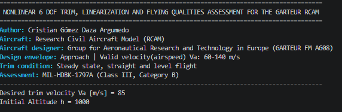
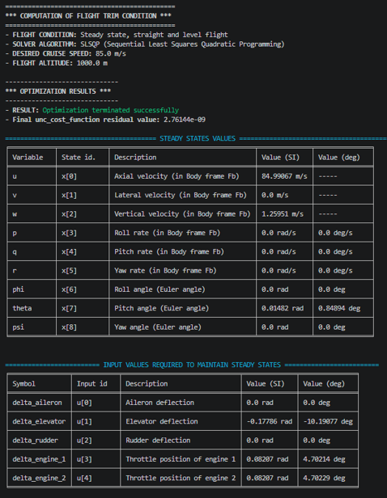
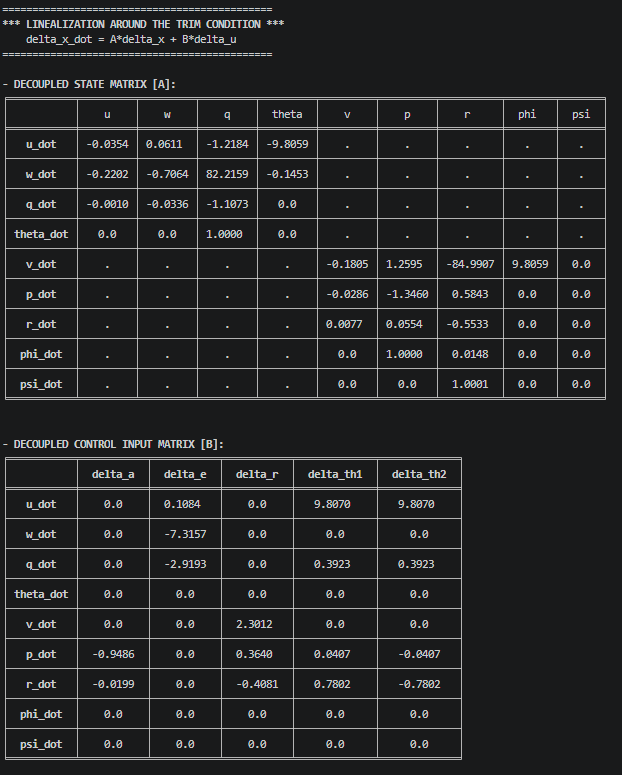
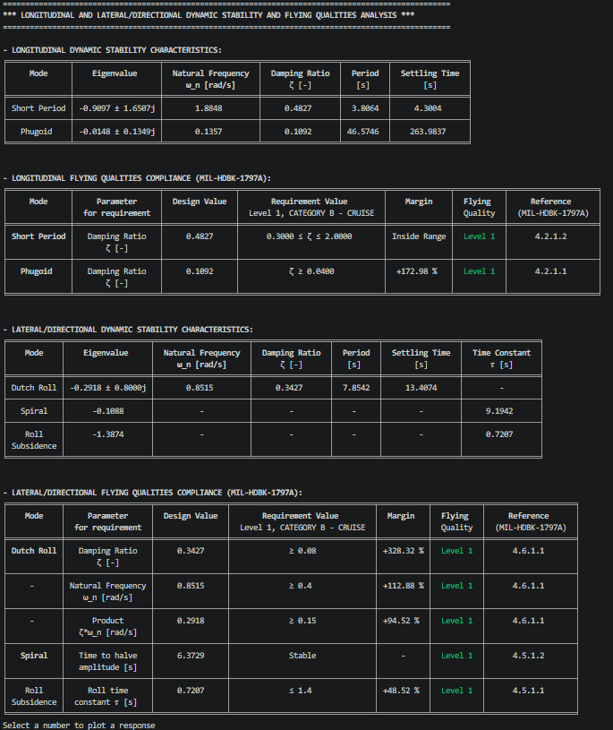

# Nonlinear 6DoF trim, linearization and flying qualities assessment for the GARTEUR RCAM

Flight dynamics toolkit for the twin engine Research Civil Aircraft Model (RCAM), which was developed by the Group for Aeronautical Research and Technology in Europe (GARTEUR[1][2]).

> **Theoretical background:** The derivation of the 6 DoF equations of motion, reference frames, and RCAM physical, geometry and aerodynamic parameters is detailed in [Chapter 2](thesis_extract/chapter_2_rcam_model.pdf) (in Spanish) of my thesis. The trim computation and numerical linearization algorithms (originally developed in MATLAB/Simulink) are documented in [Chapter 3](thesis_extract/chapter_3_trim_linearization.pdf) (in Spanish).

## OVERVIEW
This program computes and evaluates the aircraft dynamics in a steady, straight and level flight condition through the following implementations:

1. **Nonlinear 6DoF RCAM dynamics**: Implements the GARTEUR RCAM equations of motion including mass, inertia, and geometric parameters, aerodynamic forces and moments, and twin engine propulsion.
2. **Actuator & Engine Dynamics:** Models first order actuators with position and rate saturations for control inputs ($\delta_a$, $\delta_e$, $\delta_r$, $\delta_{th1}$, $\delta_{th2}$).
3. **Trim solver**: Computes the steady state, straight and level flight condition via constrained numerical optimization (SLSQP).
4. **Numerical linearization**: Extracts decoupled longitudinal and lateral/directional state space matrices ($A$, $B$) via central finite differences.
5. **Flying qualities assessment**: Evaluates flight modes against **MIL-HDBK-1797A (Class III, Category B)** Level 1 criteria[4].
6. **Nonlinear time domain response**: Compares ideal (instantaneous) control inputs against first order actuator and engine dynamics with rate and position limits under control surface and engine throttle doublet inputs.

## RESULTS

### Terminal inputs
Executing "RCAM_main.py" the terminal will require the following input at terminal to achieve the goal of steady state flight condition.

**Desired trim velocity $V_a$:** because the RCAM aerodynamic model is defined for the approach envelope, valid trim speeds comes from `60 m/s` (near minimum thrust margin) to `140 m/s` (near upper engine thrust saturation). 

**Initial altitude $h$:** used as reference at sea level, density will keep constant in all altitude, $\rho = 1.225\text{ kg/m}^3$.

**NOTE: Aircraft configuration:** Mass, inertia tensor, and geometric properties can be modified in `rcam_parameters.py`, (tables of RCAM parameters and limits are presented in [Chapter 2](thesis_extract/chapter_2_rcam_model.pdf) of my thesis extract).

------------------
The following parameters are proposed:

- **Desired trim velocity $V_a$:** `85 m/s` 

- **Initial altitude $h$:** `1000 m`

---------------
### Console outputs

1. **Simulation Header & Summary**

Displays the aircraft information, selected flight condition, and the **MIL-HDBK-1797A** reference standard used for flying qualities evaluation.

2. **Trim Condition Results** 

Two summary tables are outputed: the steady-state equilibrium vector $x_0$ and the corresponding trim control inputs $u_e$. These vectors were found via SLSQP (converging to a residual of $2.76 \times 10^{-9}$)

Notice that at $V_a = 85\text{ m/s}$, straight-and-level equilibrium is maintained with $\theta = \alpha = 0.85^\circ$. It requires an elevator deflection $\delta_e = -10.19^\circ$, and symmetric throttle $\delta_{th1} = \delta_{th2} = 4.70^\circ$ which is within actuator limits (at $140\text{ m/s}$ the engines reach upper thrust saturation).

NOTE: These vectors are important to initialize an online simulation in the steady state, straight and level flight condition, also for linearize the nonlinear system and as a reference for control system design.

3.	**Decoupled linearized state and control matrices ($A, B$)** 

Presents the longitudinal ($4 \times 4$) and lateral-directional ($5 \times 5$) state and control matrices extracted around the trim condition using central finite differences. These matrices enables local stability analysis and linear flight control law design.

4. **Dynamic Stability & Flying Qualities Assessment**
   
Summarizes the modal parameters for all flight modes and evaluates Level 1 compliance against **MIL-HDBK-1797A** for Class III, Category B.

5. ### Nonlinear doublet response 
It is presented a plotting menu which allows you to evaluate doublet responses across any of the five control inputs (perturbation parameters such as amplitude, pulse width, and start time of the doublet input can be configured in `doublet_response.py`): 

In this example, it is presented the response to a symmetric **$\pm 3^\circ$ engine throttle doublet** applied around the equilibrium throttle setting ($\delta_{th1,2} = 4.70^\circ \pm 3^\circ$), starting at $t = 10\text{ s}$ with a $5\text{ s}$ pulse duration per half-cycle ($10\text{–}15\text{ s}$ positive pulse, $15\text{–}20\text{ s}$ negative pulse):

Three subplots are presented:

- **Top subplot (Control Input):** Compares the ideal doublet command (dashed) against the actual actuator engine response (solid) which was modeled with first order equation with a time constant of ($\tau_{eng} = 1.5\text{ s}$), rate limits ($\pm 1.6^\circ/\text{s}$), and position limits ($[0.5^\circ, 10.0^\circ]$), operating within the unsaturated range ($1.70^\circ\text{–}7.70^\circ$).
- **Middle subplot (Attitude & Incidence):** Compares angle of attack ($\alpha$) and pitch angle ($\theta$) for the ideal vs. actuator model, illustrating the fast Short Period transient ($T \approx 3.8\text{ s}$) and the lightly damped Phugoid oscillation.
- **Bottom subplot (Airspeed & Altitude):** Shows the slow Phugoid energy exchange ($T \approx 46.6\text{ s}$) between airspeed ($V$) and altitude ($h$).

## REFERENCES
[1] P.F. Lambrechts et al. Robust flight control design challenge problem formulation and manual: the research civil aircraft (RCAM). Technical Publication TP-088-3, Group for aeronautical research and technology in Europe GARTEUR-FM(AG08), 1995.

[2] J.-F. Magni, S. Bennani, and J. Terlouw, Robust Flight Control, A Design Challenge (GARTEUR). Berlin, Germany: Springer-Verlag, 1997, vol. 224, Lecture Notes in Control and Information Sciences.

[3] Brian L. Stevens, Frank L. Lewis, Eric N. Johnson, Aircraft control and simulation, Controls Design and Autonomous Systems, 3rd edition Wiley 2016.

[4] U.S. Department of Defense, "Flying Qualities of Piloted Aircraft", Military Handbook MIL-HDBK-1797A, Dec. 19, 1997.
